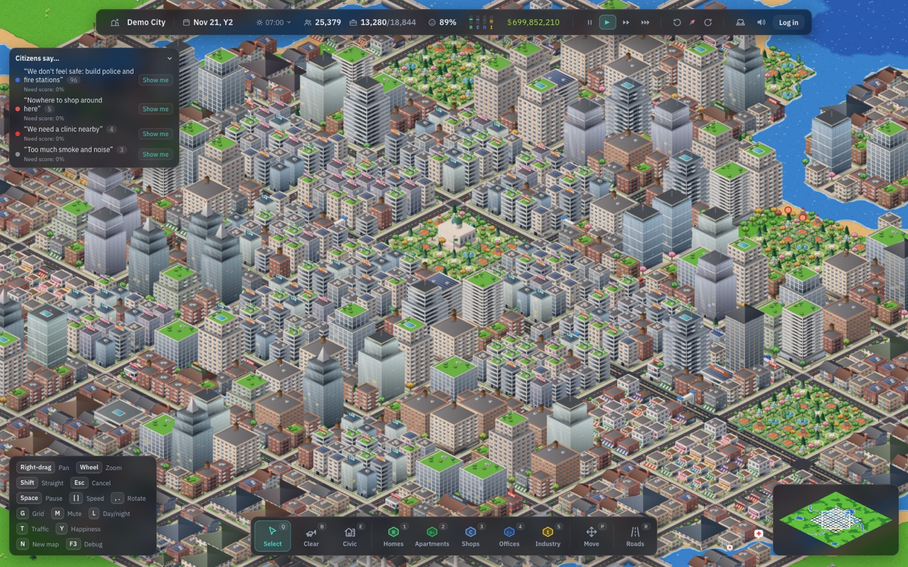
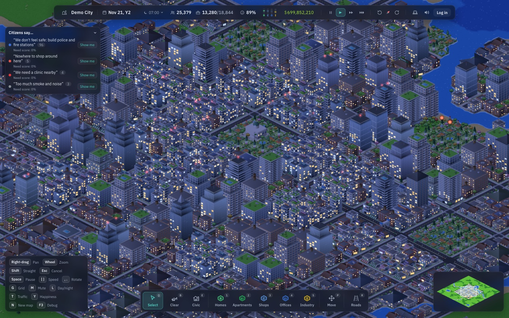

<div align="center">

# ◆ Openpolis

**Lay a road. A city moves in.**

A free, open city-building game that runs in your browser. No download, no install.

### [▶ Play now at openpolis.space](https://openpolis.space)



</div>

## What it is

Openpolis is a classic-style city builder for the web, made for everyone who grew up building towns block by block and wanted to do it again without installing anything. Zone the streets, keep the power on, balance the budget, and watch your town grow into a living city.

- **Grow a city that runs itself.** Paint residential, commercial and industrial zones along your roads. Homes, shops, offices and factories grow when there's demand, and upgrade from cottages to towers as land value rises.
- **Be the mayor.** Power plants, water towers, substations and batteries; schools, clinics, police and fire stations; taxes, upkeep and a budget that has to balance.
- **Citizens with opinions.** People tell you what their street is missing ("we need a clinic nearby", "too much smoke and noise"), and unhappy neighbourhoods empty out.
- **Real traffic.** Commuters drive the roads you build, jams form at rush hour, and streets, avenues, boulevards and expressways each carry a different load.
- **A city that's alive.** Trees sway in the wind, fountains spray, birds cross the sky, smoke drifts from chimneys, and at dusk the windows light up one by one.
- **Shape the land.** Rivers, coasts, islands and hills, with a new map every time, or pick your seed.
- **Your cities are saved.** As a guest they save on your device; with a free account they save to the cloud and open in any browser.



Every building, tree and street is drawn by code at load time: there are no image assets, and the art is original.

## Run it locally

You need [Bun](https://bun.sh) 1.4+ and, for accounts and cloud saves, Docker.

```bash
git clone https://github.com/subediaakash/sim.git openpolis
cd openpolis
bun install
docker compose up -d     # Postgres for accounts and cloud saves (optional)
bun run dev              # http://localhost:5173
```

Without Postgres the game still runs and saves on your device. Open `http://localhost:5173/demo` for a fully grown city.

| Command | What it does |
|---|---|
| `bun run dev` | The game (Vite) and the save server, together |
| `bun run test` | Unit tests (the server's use an in-process Postgres, no Docker needed) |
| `bun run typecheck` · `bun run lint` | Strict TypeScript and ESLint, both must pass |
| `bun run build` | Production build into `dist/` |
| `bun run sim:run --scenario demo --years 1` | Run the simulation headless and print per-system timings |

## How it's built

TypeScript throughout: **PixiJS 8** draws the world, **React** and **Jotai** the interface, and a small **Express + Postgres** server keeps accounts and saves. Bun runs the tooling and the server.

```
src/sim/       the simulation: pure TypeScript, no rendering or DOM (runs headless too)
src/render/    PixiJS renderer: chunked terrain, procedural art atlas, ambient life
src/app/       React interface: landing page, HUD, panels, account flow
src/game/      glue between input, simulation and rendering
server/        save server: auth, cloud saves, rate limits (config → db → http → modules)
docs/          design docs, specs, decision log, roadmap
```

The design docs start at [docs/README.md](docs/README.md): vision, architecture, every system's spec, and a log of why things are the way they are.

## Deploy your own

One Docker image serves the game and the API; it needs Postgres. See [docs/deploy.md](docs/deploy.md) for a step-by-step VPS guide.

## Contributing

Bug reports, ideas and pull requests are welcome. Read [CONTRIBUTING.md](CONTRIBUTING.md) to get set up and to see how the project works.

## Credits

Openpolis is an original game inspired by the classic city builders of the 90s and 2000s. It is not affiliated with, endorsed by or connected to Electronic Arts, Maxis or any other publisher; it uses none of their code, art or assets.
