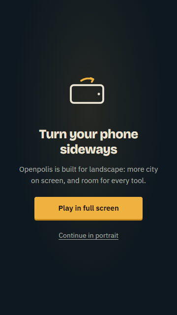
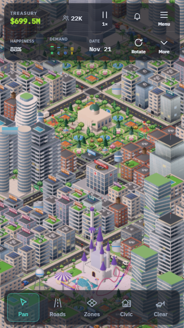
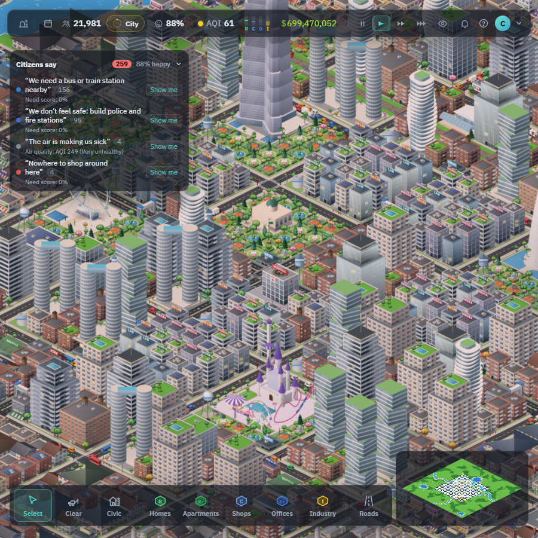
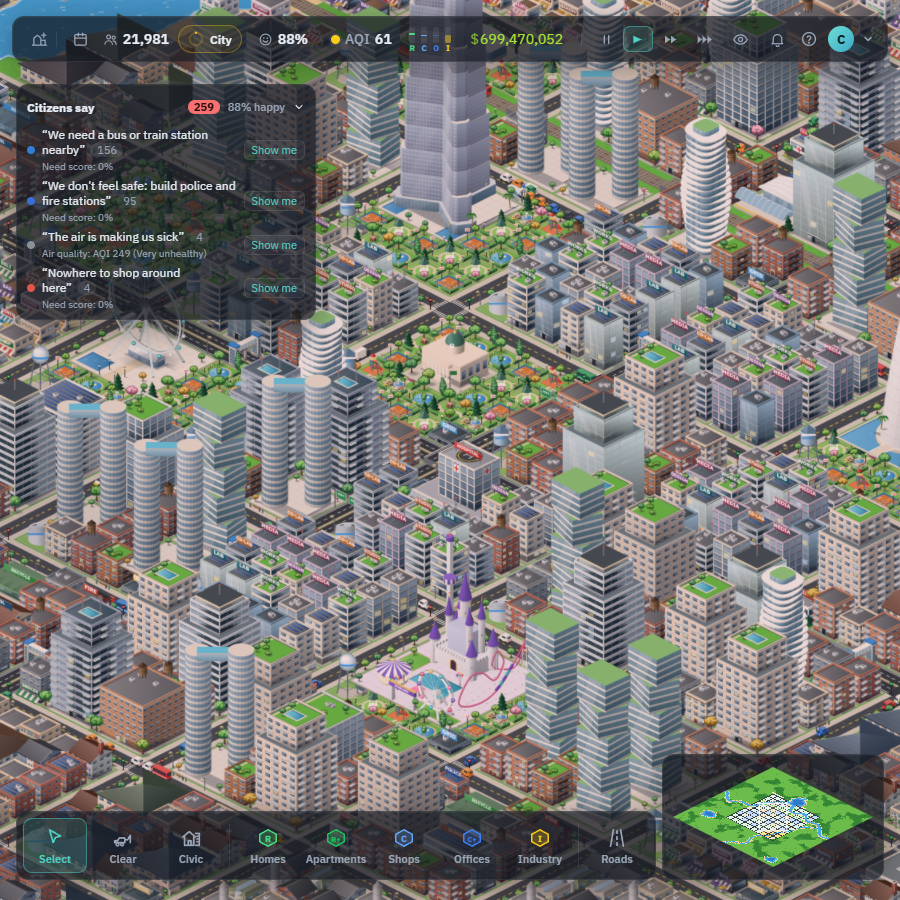

# Android contribution readiness

This is preparation for a possible contribution to [subediaakash/openpolis](https://github.com/subediaakash/openpolis). The current review remains in the fork. No upstream issue or pull request has been submitted.

The audit used upstream [CONTRIBUTING.md](https://github.com/subediaakash/openpolis/blob/d066b1b8dcdbf40bffa09320e56696845b421ed9/CONTRIBUTING.md) and `CLAUDE.md` at `d066b1b8dcdbf40bffa09320e56696845b421ed9`, which was also upstream main when checked on 2026-11-05. There was no `.github` directory or separate pull-request template at that revision. Recheck the base and guidelines before submission.

## Checklist

| Upstream requirement | Evidence or remaining action |
|---|---|
| Discuss large changes in an issue first | Still open. Use the draft below to agree scope with the maintainer before an upstream PR. |
| Feature spec in `docs/specs/` | [Android spec](specs/android.md) describes behavior, architecture and acceptance. |
| Numbered decisions, roadmap and progress log | D-097, Android roadmap checklist and dated progress entries. |
| Bun tooling and lockfile | Only `bun.lock`; no npm, Yarn or pnpm lockfiles. Commands remain Bun scripts. |
| Strict TypeScript | Named readonly props for the new exported phone components; the input test double documents why its DOM cast is safe. Typecheck and lint cover the change. |
| Pure, deterministic simulation | No changes under `src/sim/` or `src/shared/`; compare headless benchmark end states below. |
| Original art and MIT licensing | Existing procedural game artwork and Openpolis diamond mark are retained. Original MIT notice and bundled font licenses are included. |
| Backend layering and migrations | Server, schema and deployment code are unchanged; original save endpoints remain. |
| Tests and zero-error checks | See [recorded validation](ANDROID.md#android-only-pr-validation-2026-11-05). |
| Before/after screenshots in the PR | Comparison images below are linked in the fork PR description. |
| Performance-sensitive changes report measurements | Headless and browser methods/results below. Physical Android 60 FPS is still unverified. |
| Conventional commit messages and plain docs | `feat:` and `docs:` commits; Android docs use the repository's existing Markdown layout. |

## Visual comparison

Captures use Chrome, a developed `/demo` city, the original Openpolis artwork and controlled API responses. The baseline is unchanged upstream; the proposed client is the native production build. Accounts are mocked only for capture and are not evidence of production account compatibility.

| Layout | Before | After |
|---|---|---|
| Portrait, 360×640 |  |  |
| Expanded, 900×900 |  |  |

## Performance measurements

Measurements use the same Windows ARM64 host with x64 Bun 1.4.4. The unchanged upstream snapshot and proposed branch run sequentially. These are single-run comparisons, not a statistical performance guarantee.

Headless: `bun run bench` builds the developed river-valley city with seed 42 and size 128, then runs another 360 simulation days with per-system budgets. Browser: Chrome headless with `--enable-unsafe-swiftshader`, `/demo`, a three-second warm-up and ten seconds of `requestAnimationFrame` cadence per viewport. The flag permits software WebGL; the actual GPU renderer was not recorded. Cadence includes main-thread stalls and does not measure physical Android GPU presentation. Initial canvas visibility is not a fully interactive startup measurement.

| Headless metric | Upstream baseline | Proposed branch |
|---|---:|---:|
| Initial city build | 6,645 ms | 5,875 ms |
| Additional 360 simulation days | 34.8 s | 34.7 s |
| Average per day | 96.8 ms | 96.4 ms |
| Final population / buildings | 22,359 / 1,692 | 22,359 / 1,692 |
| Final day / happiness / funds | 1020 / 79% / $1,001,145,496 | 1020 / 79% / $1,001,145,496 |

Both runs exceeded existing budgets for `commute.day`, `needs.day`, `needs.change` and `budget.month`. Commute averaged 62.47 ms against a 25 ms budget in both. The normal benchmark exits successfully while reporting these overruns; it is not a strict budget pass. The small timing differences do not establish an improvement. Logs: [baseline](images/android/baseline-bench.txt), [proposed](images/android/proposed-bench.txt).

Raw browser samples are stored in [measurements.json](images/android/measurements.json).

Chrome 156.0.8078.80 produced these callback-cadence samples. Headless cadence is not tied to physical display refresh and can exceed 60 callbacks/second.

| Browser scenario | Callbacks/s | Median / p95 interval | Maximum interval |
|---|---:|---:|---:|
| Upstream expanded, 900×900 | 119.05 | 8.3 / 8.4 ms | 91.7 ms |
| Native expanded, 900×900 | 118.98 | 8.3 / 8.4 ms | 91.6 ms |
| Native portrait, 360×640 | 118.93 | 8.3 / 8.4 ms | 100.2 ms |

No page errors were observed in any capture. The equivalent expanded samples show no visible cadence difference in this run, but occasional long intervals remain. Baseline portrait displays its rotation prompt, so it is shown as a screenshot rather than compared as active gameplay. No physical Android frame-rate claim follows from these numbers.

The frame loop retains its existing cadence. Input adds gesture state, the HUD reads existing event-backed atoms, and lifecycle work runs on transitions. No simulation or renderer implementation changes are included. Physical Fold frame timing, thermal endurance and real-account behavior remain required device acceptance work.

Audit revalidation passed `bun run typecheck`, `bun run lint` and `bun run test -- --maxWorkers=2 --testTimeout=60000` (293 tests in one run). `adb devices` listed no attached devices. The audit changes only documentation, type declarations and the documented test-double helper; production runtime behavior is unchanged.

## Upstream issue draft

**Title:** Discuss an optional Capacitor Android client with portrait controls and offline local play

I'd like to contribute an Android client that reuses the existing simulation, renderer and React UI. It bundles the game and fonts, supports portrait/landscape/foldable layouts, confirms touch construction, and saves/pauses on backgrounding. A fork PR is available for evaluation: [Android client](https://github.com/cbulock/townward/pull/1).

The proposal preserves Openpolis branding and the existing hosted backend. Browser trial/account behavior remains as it is. Native local play is unlimited and offline; optional email accounts use the original API. GitHub OAuth is hidden until a native callback exists. There are no hosting, email-provider or database changes, no release signing, and no store publication.

Would this fit the project's direction? In particular, is unlimited offline local play appropriate for the native client, should native accounts remain in the first contribution, and what application ID/build ownership should an official version use? Would you prefer one Android PR or separate changes for touch controls, lifecycle and packaging?

The fork includes tests, screenshots and desktop measurements. Physical Android/Fold acceptance, production account cookies/anti-abuse compatibility and sustained device performance remain open. I would confirm scope and finish the agreed acceptance work before asking to merge upstream.
